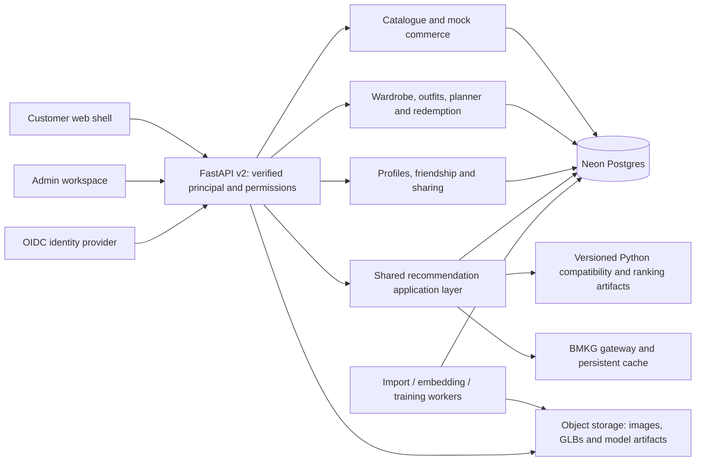
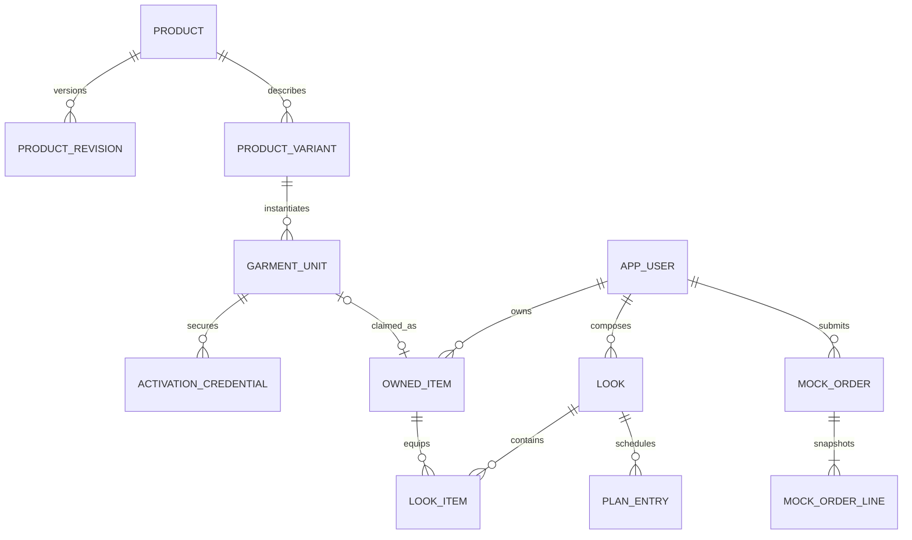

# Wearhouse — Ecosystem Technical Design Document

**Version:** 1.1 · **Date:** 25 November 2026 · **Status:** proposed implementation baseline.

**Brand revision:** the project and customer-facing product name is **Wearhouse**. Historical research titles, source paths and evidence identifiers retain “Digital Wardrobe” for traceability. This revision changes the name only; architecture and scope remain as specified.

**Purpose:** replace the crowded single-user demonstration with a coherent fashion ecosystem inspired by Steam's separation of catalogue, library, community and identity. This document specifies the build; it does not claim the new features exist or that the platform is ready for public production use.

**Decision authority:** the user's brief, methodology v11, inspected source and the [unified decision record](UNIFIED_DECISION_MANIFEST_DIGITAL_WARDROBE_v1.md). Pool-based Understanding review is pending a user-supplied pool directory. Architectural proposals below are explicit project decisions, not fabricated Pool rules. Existing demo TDD remains historical documentation; this TDD governs the proposed ecosystem. No application code, deployment or research text is changed by this review.

## 1. Product contract and research boundaries

Wearhouse has two connected centres: discover clothing that improves a wardrobe, and use the clothing already owned. Each garment is an addressable item with imagery, metadata, ownership state, rendering assets and history. A recommendation is a link to those objects or an outfit assembled from them, rather than a line of descriptive text.

The customer can browse a real-source catalogue, wishlist items, complete a clearly simulated purchase, receive a private activation key, redeem it, organise an owned wardrobe, equip an avatar, obtain context-aware outfits, schedule seven days, record actual wear, and share selected looks with friends. The administrator imports and curates source products, publishes releases, maintains category/media mappings, and issues serialized units. No retailer partnership is required for this controlled ecosystem. A simulated receipt establishes an application entitlement; it does not authenticate ownership of a physical garment outside the system.

| ID | Requirement and authoritative basis | Implementation surface | Verification |
|---|---|---|---|
| F01 | Existing catalogue, not invented product data; brief and thesis §3.3 | Source imports and catalogue | Provenance and import fixtures |
| F02 | Shared fashion intelligence; thesis §§3.4.1–3.4.3 | Shared embeddings/compatibility; separate rankers | RQ1/RQ2 evaluations |
| F03 | Real item identity, key and lifecycle; brief, §3.4.4 | Product, variant, unit, owned item | Transaction and identity tests |
| F04 | Dedicated redemption; brief and two-code thesis contract | Redeem menu and private-key API | Public QR cannot claim; replay/race tests |
| F05 | Visual wardrobe, avatar, accessories; §3.4.5 | Library, fitting room, item inspector | Slot and rendering tests |
| F06 | Seven-day timeline on profile; brief | Profile timeline linked to planner | Date/permission/wear tests |
| F07 | Mock purchasing and wishlist; brief | Catalogue commerce | Idempotent order-to-key flow |
| F08 | Friends and profile ecosystem; brief extension | Community and profile | Friendship/privacy tests |
| F09 | Admin supplies products; brief | Separate admin workspace | Import/publish/unpublish audit tests |
| F10 | Steam-inspired feminine fashion interface; brief, four references | Shared shell and Focus mode | Responsive/keyboard visual acceptance |
| F11 | Independent, complete ecosystem; brief | All flows persist across sessions | Two-user end-to-end scenarios |
| F12 | Indonesian weather, occasion and rotation; RQ2 | Wardrobe recommendations | Weather recovery and rules tests |
| F13 | Uncoded/thrifted garments; thesis §§1.5, 3.4.4 | Manual add | Unverified item path and image handling |

Research fidelity and product extensions are tracked separately. Friends, mock checkout, visual redesign and profile customisation are product requirements, not new evidence for RQ1–RQ4. Research evaluation continues to use public anonymised data and simulated users. Any later real-user deployment changes the data-collection assumptions and requires a separately reviewed operating plan.

The thesis contains bracketed settings such as [300], [0.90], [500] and percentage targets. Treat them as proposed experimental settings to freeze before testing, not measured achievements. Existing course M1–M5 integration measurements remain distinct from RQ1–RQ4 outcomes.

## 2. Findings from the existing implementation

Reviewed baseline: `ea21b05`, with four available commits dated 24 November 2026 and pre-existing uncommitted dependency changes. This is enough to identify transitions, not enough to claim years of proven operation. [History stream](HISTORICAL_EVENT_STREAM.md) records the narrow window.

| Component | Evidence in source | Reuse or required change |
|---|---|---|
| Frontend | `Frontend/frontend/src/app.js`: shared mutable page state, hash navigation, large HTML render functions for fitting/plan/wardrobe/register/demo | Extract shell, routes, feature modules and typed view models; move diagnostics to admin/development |
| Presentation | `avatar.js`: coloured SVG silhouettes; `viewer.js`: procedural Three.js preview with GLTFLoader/template replacement support | Retain fallback and loader; verify existing asset coverage and extend product photography, inspector, templates and texture preparation |
| Frontend stack | Vite 7, Three.js 0.180, TypeScript tooling; implementation largely JS | Incrementally migrate touched modules to TypeScript; no mandatory framework rewrite |
| Local backend | FastAPI, SQLAlchemy; `models.py`, `services.py`, `rules.py`, `scoring.py` | Keep Python domain as new canonical engine; add proper migrations and feature boundaries |
| Public backend | `neon-backend/index.mjs`: Hono, pg, fixed seeded user, inline routes/SQL; `rules.mjs` duplicates scoring | Maintain v1 compatibility during migration; retire duplicated new-domain business logic |
| Identity | `backend/app/deps.py::current_user` returns demo UUID; `api.js` sends shared demo key | Replace with verified identity, server role checks and owner-scoped data access |
| Ownership | Both backends expose `POST /garments/scan`; tag page auto-posts public serial | Remove ownership mutation from scan flow; supersede tests that currently demand it |
| Product data | Synthetic seed products, GTIN primary key; owned garments copy attributes | Add source product UUID, source IDs, variants, media, units and provenance; GTIN becomes optional |
| Recommendations | `scoring.py::compat`: pairwise colour/style heuristic; exhaustive combination generation | Preserve as labelled baseline; implement thesis model and bounded retrieval |
| Weather | Validation, TTL and fallback tests; source labels; fault expiry | Preserve behaviour, move shared cache to persistent storage; isolate fault control |
| Quality assets | pytest, Node parity tests, frontend unit tests, Playwright, `measure.py` | Retain applicable suites and explicitly revise changed QR/auth contracts |
| Docs vs reality | `Frontend/PRODUCT.md` describes same-origin Python; deployment docs describe cross-origin Node | Separate legacy deployment from target; publish one environment matrix |
| New dependencies | Neon Auth and JOSE appear in working-tree manifests | Dependency presence is not evidence of implemented authentication |

**Research deviations requiring explicit resolution:** (1) public QR currently grants ownership; (2) demo has six broad slots rather than thesis accessory positions; (3) heuristic compatibility is not FashionCLIP/type-aware compatibility; (4) current heat rule excludes every heavy garment while thesis specifies heavy outer layers; (5) research catalogue/training pipeline is absent from the inspected application structure. Correct these through versioned contracts and tests, rather than relabelling demo behaviour as research completion.

## 3. Steam reference analysis and fashion translation

This analysis concerns observable product architecture and documented Steamworks concepts. Valve's internal service topology, private databases and ranking implementation are not public evidence and are not assumed here.

The supplied Store screenshots (`122759`, `122849`) show global destinations above contextual browse/search/wishlist controls. The Library screenshot (`122914`) separates collection navigation from portrait cover shelves. Big Picture (`122951`) gives the focused object more area and reveals metadata beneath a horizontal rail. The lesson is hierarchy and progressive disclosure: a stable destination, a scoped task, then a focused object. Copying every Steam toolbar would recreate clutter.

| Steam concept | Fashion equivalent | Design consequence |
|---|---|---|
| Store | Catalogue | Public discoverable source products; recommendation shelves and wishlist |
| Game library | Wardrobe | Only owned or manually declared garments; collections and usage history |
| Game/store detail | Product detail and owned-item inspector | Distinct actions for unowned product versus owned instance |
| Inventory item definition/instance | Product definition and serialized garment unit | Product metadata is shared; owner and lifecycle belong to instance |
| Activation/product key | Private garment redemption | Dedicated menu, one-time claim and generic failure |
| Community/friends | Friends and shared outfits | Sharing is opt-in and server filtered |
| Profile and activity | Fashion identity and seven-day timeline | Personalisation plus planned/worn states; private by default |
| Steamworks publishing | Admin catalogue workspace | Import, validate, review, publish, retire; all audited |
| Big Picture | Focus mode | Same data/routes with larger tiles, focused navigation and quiet chrome |

Steamworks documents persistent inventories and schema-defined items; that supports the definition/instance analogy, not an obligation to use Steam APIs. [Steam Inventory Service](https://partner.steamgames.com/doc/features/inventory), [Inventory schema](https://partner.steamgames.com/doc/features/inventory/schema). Valve describes Big Picture as a reformatted experience supporting controller, keyboard and mouse; Focus mode borrows this presentation principle. [Big Picture](https://store.steampowered.com/bigpicture).

Physical garments differ from virtual items: real wear, care state and possession matter; digital revocation does not destroy clothing. Digital records must distinguish verified-by-key, manually declared and sandbox provenance. Trading, resale settlement, lending, real checkout, retailer fulfilment and a Steam-style cash marketplace are future scopes. Friends, wishlist and simulated purchases are required for this release.

## 4. Information architecture and navigation

One shell persists across customer routes. Desktop primary navigation: **Catalogue · Wardrobe · Community · My Profile**. Utilities: scoped search, wishlist, notifications and account menu. **Redeem a garment** is a named account-menu destination and a Wardrobe shortcut, with its own full page. Settings are grouped under Account, Preferences, Appearance, Privacy and Location. Admin entry is visible only to authorised roles and opens a separate workspace.

Use hash routes initially for compatibility with GitHub Pages; API resource names remain clean and independent of client routing. Deep links must retain the `/LIVE-DEMO/` deployment base. A later hosting move may use history routes without altering resource IDs.

| Route after `#/` | Purpose | Primary action |
|---|---|---|
| `catalogue` | Featured, For your wardrobe, New arrivals, browse/filter | Open product |
| `catalogue/products/:productId` | Images, attributes, source, compatibility and mock offer | Wishlist or simulated purchase |
| `wishlist` | Persistent saved products, availability states | Open product |
| `cart`, `checkout`, `orders/:id` | Mock transaction and receipt | Complete simulated purchase / reveal key |
| `wardrobe` | Owned items, collections, recent/underused shelves | Inspect item |
| `wardrobe/items/:ownedItemId` | Instance provenance, history, care status | Equip / plan |
| `wardrobe/looks`, `wardrobe/looks/:id` | Saved compositions | Equip / schedule |
| `wardrobe/fitting-room` | Avatar, slot list and item picker | Save look |
| `wardrobe/planner?week=YYYY-Www` | Seven dates with look and context | Schedule / mark worn |
| `redeem` | Private-key input and success receipt | Redeem |
| `wardrobe/add` | Manual/thrifted garment with photo | Add declared item |
| `community/friends`, `community/requests` | Search, requests, friends, blocks | Invite / accept |
| `profile/:handle` | Selected showcase, collections and permission-filtered seven-day timeline | View shared look |
| `settings/:section` | Account and preferences | Save |
| `admin/*` | Imports, products, releases, units, assets, audits and moderation | Role-specific workflow |

Wardrobe is a self-contained work area: Collections, All garments, Looks, Fitting room, Planner. Catalogue filters are not wardrobe controls. Wishlist is not ownership; cart is not inventory. Planner is a functional editor, while the profile timeline is its presentation projection. They read the same plan records.

## 5. Visual and interaction specification

### 5.1 Direction

Use the existing fashion palette as a foundation: paper `#faf6f3`, ink `#2b1624`, plum `#632947`, blush `#f1e0e6`. Add a dark aubergine Focus surface and soft rose selection accent. The feminine direction comes through colour, photography, typography and soft lighting; it does not restrict users, garment categories or body choices. Contrast must be measured for actual text/background pairs before release.

DM Sans/system sans-serif handles navigation and dense metadata. Cormorant/Georgia handles editorial headings, never tiny functional labels. Space tokens: 4/8/12/16/24/32/48/64 px; modest 8–12 px corners; one primary CTA per object context; thin separators and limited badges. Filters collapse after applying on small screens. No diagnostic tables, activation issuance forms or fault controls on customer home pages.

### 5.2 Tile and object system

| Object | Ratio / media treatment | Essential information | Selection result |
|---|---|---|---|
| Product tile | 2:3 portrait, garment fully visible with `object-fit: contain` | Name, source label, mock price/availability, wishlist | Product detail |
| Owned-item tile | 2:3 portrait using the same product asset | Name, owned/care state; no purchase CTA | Instance inspector |
| Look tile | 3:4 avatar render or outfit collage | Look name, occasion; scheduled marker | Look detail |
| Featured/lookbook card | 16:9 editorial crop from permitted assets | Short title and one action | Curated collection |
| Timeline day | Date + portrait preview | Planned/worn/empty and weather availability | Planner day |

A rectangular tile is a resource link, not an entire dashboard in miniature. No more than two status badges; details expand in inspector/page. Unknown media uses a category silhouette with the label “Image unavailable”; it never presents stock photography as the actual product. The inspector shows front/back images where available, category, fabric/colour source, owner-customised name, provenance, serial (owner only), acquisition, care state, last worn and available actions.

### 5.3 Desktop wireframes

```text
CATALOGUE · WARDROBE · COMMUNITY · PROFILE        Search  ♡  Account
Catalogue / For your wardrobe
Browse  Categories  Filters                    [Redeem in account menu]
┌────────────────────────────────────┬─────────────────────────────┐
│ One editorial feature / look       │ Focused look or product     │
│ permitted imagery                 │ Why it complements you      │
│                                   │ [View collection]           │
└────────────────────────────────────┴─────────────────────────────┘
Completes your wardrobe       [portrait] [portrait] [portrait] ...
New arrivals                 [portrait] [portrait] [portrait] ...

WARDROBE
Collections   │ Search owned items             Grid / Focus
All garments  │ Continue styling [large focused look] [recent items]
Looks         │ Not worn recently [portrait] [portrait] [portrait]
Fitting room  │ All garments       [portrait] [portrait] [portrait]
Planner       │

PROFILE
Avatar + display name + chosen showcase        Edit / Friendship action
Your seven days  Mon  Tue  Wed  Thu  Fri  Sat  Sun
                 [look thumbnails, explicit planned/worn labels]
Shared looks / selected collections
```

Focus mode shows a dominant selected tile, adjacent portrait tiles and a detail zone beneath it. It supports arrow-key movement, Enter to open, Escape to return and visible focus; optional controller input maps to those same actions. It does not replace semantic DOM controls with a canvas-only interface. A tile rail has explicit previous/next controls and a grid alternative; no required auto-scrolling or autoplay.

### 5.4 Responsive and accessible behaviour

At desktop widths use a maximum reading width around 1440 px, a 240 px wardrobe sidebar, and 5–6 portrait columns as space allows. At tablet widths collapse sidebar to a drawer and show 3–4 columns. At 360–430 px use two portrait columns, a compact top bar and bottom navigation for the four primary destinations. Wishlist/redeem remain reachable through labelled utilities. Day planner becomes a date strip and one day editor; no seven-column horizontal form.

All core flows work with keyboard and screen reader, persistent labels and announced validation/results. Target WCAG 2.2 AA, minimum 44 px touch controls, reduced-motion support, correct modal focus return and meaningful image alternatives. Tile image and title share a single link; wishlist is a separate labelled button, never a nested button in a link. Layout remains usable at 200% zoom. Loading skeletons preserve tile dimensions; recoverable errors keep user input and provide retry. Empty wardrobes offer redeem/manual add; empty catalogue filters offer clear filters; recommendation failure preserves browsing.

## 6. Target architecture and deployment transition

**ADR-01:** use a modular Python application with explicit domain boundaries, not a distributed service for every Steam menu. The wardrobe is its own product ecosystem and ownership boundary without requiring its own deployment. Preserve Vite/Three.js, Neon Postgres and the existing Python logic. Move research inference/training out of browser and Node request handlers.



Bounded modules: Identity; Catalogue; Media; Commerce sandbox; Ownership/Redemption; Wardrobe/Outfits; Recommendations; Weather; Planner; Social/Profile; Administration/Audit. Routers call application services; services enforce rules and call repositories/adapters. Frontend receives capability flags for display, but server permissions remain authoritative. Media and model artifacts live in object storage, not GitHub Pages bundles or database blobs.

**ADR-02 deployment:** retain existing v1 Pages + Neon Function demo during construction. Deploy FastAPI v2 to a Python-capable host selected in Phase 0; this host is not yet provisioned. Start with modest CPU inference using cached embeddings/pair scores; train asynchronously on suitable compute. Keep v1 and v2 API origins explicit. Route the new shell entirely to v2 once migrated; never let the two applications concurrently mutate the same ownership schema. A new versioned schema/database branch isolates v2 until cutover.

**ADR-03 frontend:** progressively split `app.js` into typed route modules and shared components, using existing tooling. Proposed layout:

```text
Frontend/frontend/src/
  shell/ routes/ components/ api/ state/ theme/
  features/catalogue/ wardrobe/ redemption/ commerce/ planner/ social/ profile/ admin/
backend/app/
  identity/ catalogue/ media/ commerce/ ownership/ wardrobe/
  recommendations/ weather/ planner/ social/ admin/
  common/ repositories/
backend/migrations/  backend/jobs/  backend/research/
```

Server responses own persisted state. Keep only composition drafts, focused selection and UI preferences locally; cache private data by authenticated user and clear it on sign-out. Abort obsolete requests on route/filter changes; reject out-of-order results. No activation keys, access tokens or private wardrobe snapshots in analytics or persistent local storage.

## 7. Identity, permission and privacy contract

Use a standards-based OIDC provider with Authorization Code + PKCE for the static web client and issuer/audience/signature/expiry verification in v2. Select and pin a supported provider during Phase 0; the installed Neon Auth beta is a candidate to evaluate, not proof of production support. No custom password database in the wardrobe service. Keep access tokens in memory; use provider-supported session renewal. Exact logout, refresh, browser-storage and origin behaviour must pass the provider spike before dependent work.

`app_user` stores the provider subject mapping, profile handle, locale, timezone and preferences. Derive actor ID from the verified token, never a request `owner_id`. Roles: customer, catalogue_editor, inventory_manager, moderator, admin. Customers cannot import, publish or mint keys; editors cannot grant themselves ownership; moderators do not receive activation-key visibility. All administrator mutations produce an audit event. An authenticated user can invite friends and publish their own selected look, but cannot access another user's private wardrobe through guessed IDs.

Default privacy: wardrobe, wishlist, purchases, wear history, location and seven-day timeline private. A profile may expose a chosen showcase. A shared look contains an intentional snapshot of garment presentation, not private serials, receipts or wear history. Audience choices: private, accepted friends, public; final visibility is the intersection of record policy, profile policy and block relationship. Blocking overrides friendship and immediately removes access. Timeline exposure is separately enabled; location and future schedule are never automatically shared with profile visibility.

## 8. Catalogue source, ingestion and provenance

**ADR-04:** use the thesis's **H&M Personalized Fashion Recommendations** article/image catalogue as the initial canonical research catalogue, with source-namespaced IDs. Polyvore Outfits supplies compatibility training/evaluation and simulation items, not substitute purchase labels. FashionCLIP supplies image embeddings. This follows thesis Table 3 and §§3.3–3.4 rather than choosing an unrelated attractive dataset.

H&M is a historical research snapshot, not a live retail API. Its article IDs are not GS1 GTINs, and its transaction price values must not be shown as current retail prices or converted into invented actual offers. Mock offers get explicit `sandbox` currency/amount policy and a visible “Simulated price” label. No claim of stock, partnership or shipping.

Source links: [H&M competition data](https://www.kaggle.com/competitions/h-and-m-personalized-fashion-recommendations/data), [competition rules](https://www.kaggle.com/competitions/h-and-m-personalized-fashion-recommendations/rules), [Polyvore author repository](https://github.com/mvasil/fashion-compatibility), [FashionCLIP author repository](https://github.com/patrickjohncyh/fashion-clip). Kaggle rules were not readable in this session, so unrestricted public redistribution is **not verified**. Access acceptance, dataset terms, image rights and model-weight terms are Phase 0 gates. Code licences do not establish rights to every image or weight. For restricted assets, run authenticated academic preview or use explicitly permitted imagery; do not silently replace the research catalogue with fabricated products. No large download or licence acceptance is part of this TDD task.

Import pipeline: source snapshot + checksum → parse article IDs as strings (preserve leading zeros) → staging → category mapping → media validation and rights record → attribute enrichment → embedding jobs → editor review → immutable published revision. Repeat imports upsert by `(source_id, external_product_id)`; removal retires catalogue visibility, never deletes owned units. A failed job remains retryable with row-level errors. Publishing uses an outbox/job so partial embedding failures cannot expose half-valid products.

Store original metadata and normalized metadata separately. H&M source fields can map article/product codes, descriptions, product type, colour, garment group, section and department. Do not invent a size chart, fabric, rain protection or GTIN when the source lacks them. Enriched attributes carry `value`, `origin` (source/curator/rule), confidence, mapping version and review status. Unknown weather/dress-code attributes remain unknown; strict contextual recommendations require verified supporting attributes or exclude the item with an explanation. The fixed simulation lookup table is permitted as research annotation, explicitly distinct from verified retail characteristics.

Admin workflow: **Import → Validate → Review → Publish → Revise/Retire**. Editors may publish a curated source-derived subset first; full-catalogue scale is a later measured gate within this release. An independently created product requires a documented legitimate source or licensed contribution; free-form invented catalogue records are not the default publication path. Manual garments remain valid private user declarations.

## 9. Domain model: definitions, physical units and digital ownership

**ADR-05:** separate shared product facts from each garment's identity. Two identical shirts can share one product definition but have separate units, keys, owners, care state and wear histories.

| Entity | Key fields and invariant |
|---|---|
| `catalogue_source`, `source_snapshot` | Source namespace, upstream URL, version/checksum, terms reference, visibility permission |
| `product`, `product_revision` | Internal UUID; unique source/external ID; immutable revisions; draft/published/retired; source category and normalized type |
| `product_variant` | Product FK; optional source variant ID/size/colour; unknown remains unknown; no fabricated source SKU |
| `product_identifier` | Scheme/value/issuer for legitimate GTIN or other identifiers; source IDs remain separately namespaced |
| `media_asset` | Product/revision, object key, dimensions, view type, checksum, rights, processing status |
| `category`, `slot_definition`, `category_slot_rule` | Stable type IDs, occupied slots and optional attachment points |
| `render_template` | Category/body mapping, GLB version, texture layout, attachment rules, fallback |
| `garment_unit` | UUID, product/variant/revision, unique random public serial, sandbox/external provenance, lifecycle; no secret in QR |
| `activation_credential` | Unit FK, unique digest, issued/redeemed/revoked state, claim audience if bound; one valid live credential per unit |
| `owned_item` | UUID, owner FK, nullable unit FK unique, acquisition source, current care status, display override; manual item has no verified unit |
| `ownership_event` | Append-only unit/item event, actor, action, time, reason; restricted to authorised audit readers |
| `look`, `look_item` | Owner and revision; owned-item references; slot conflicts validated transactionally |
| `look_slot_occupancy` | Unique `(look_id, slot_id)`; occupied positions derived from item/category rules |
| `wardrobe_collection`, `collection_item` | Owner-scoped named collection; unique collection/item membership; only the owner's items can be members |
| `plan_entry` | Owner, local date, timezone, look revision, occasion, status, version; at most one active planned look per owner/date in v1 |
| `wear_event`, `wear_event_item` | Actual local date and item snapshots; unique client operation ID per owner; immutable wear evidence |
| `wishlist_entry` | Unique `(owner_id, product_id)`; availability projection |
| `cart`, `cart_line`, `mock_offer` | Owner, version, product variant, quantity, labelled sandbox price |
| `mock_order`, `mock_order_line` | Owner, unique idempotency key, price/product snapshots, terminal status |
| `receipt_secret` | Encrypted activation-key envelope for buyer receipt, access audit and deletion policy; not normal catalogue data |
| `friend_request`, `friendship`, `user_block` | Unique unordered pair for friendship/request constraint; self-invites forbidden; blocks take precedence |
| `shared_look`, `profile`, `notification` | Explicit audience, presentation snapshot, actor and recipient scoped |
| `recommendation_run`, `recommendation_event` | Model/data/rules versions, context digest, displayed candidates, deduplicated choose/wear events |
| `import_job`, `audit_event`, `outbox_event` | Durable job state and transactional external-effect delivery |

Relational constraints enforce FK integrity, unique unit ownership, valid lifecycle values and duplicate prevention. Use integer minor units plus a currency code for mock amounts. Store instants in UTC and preserve local date/timezone for planning/wear. Index owner + date, owner + acquisition/status, source + external ID, published category, product media, friendship pair, activation digest and unprocessed outbox.



Product edits never rewrite past orders or garment identity. Owned items may render an updated permitted image through a versioned mapping, but the acquisition revision remains auditable. Retirement disables new catalogue purchases and preserves the library. Archive an item to remove it from suggestions; preserve historical look/wear snapshots. Manual item deletion can remove private media through a cleanup job while retaining minimal referential history as required by the selected account policy.

## 10. Ownership and mock commerce state machines

### 10.1 Two-code contract

Public QR encodes an addressable unit/product lookup. If a legitimate GTIN exists, use the GS1 Digital Link path; otherwise use `/items/:publicSerial` with an internal namespace. Never forge GTINs for H&M article IDs. Lookup opens product detail and offers **Add to wishlist**. GET, link preview, camera scan and copied public serial must create zero ownership records.

Private activation key: preserve at least the thesis's 80 random bits, 16 base32 characters formatted in four groups; use CSPRNG and an explicit ASCII format validator before normalization/hash. Never silently discard arbitrary invalid characters. Store a cryptographic digest for lookup and compare/claim through the server. Public serial remains 128 random bits with a database uniqueness constraint. Keys are never in QR URLs, route query strings, telemetry or browser caches.

```text
Unit:       issued_unclaimed → owned → archived
Credential: issued → redeemed
                   ↘ revoked
Order:      draft → completed
                 ↘ cancelled / failed
```

A completed mock order creates one unit and one credential per purchased quantity. Checkout does not itself create an owned item: the receipt links to Redeem. For sandbox purchases bind credentials to the buyer; an externally issued receipt code can be bearer-style if the issuing policy permits. Both paths require an authenticated account. A successful redemption atomically transitions the credential, claims the unit, inserts the owned item and ownership event, and creates an outbox event. Any failure rolls back all of them.

Transaction sketch: persist/check authenticated attempt allowance → locate digest and lock eligible credential/unit → enforce audience → conditional claim where still unclaimed/unrevoked → insert item with unique unit FK → append events → commit. The unique ownership constraint is a second defence against races. Commit failed-attempt accounting independently so rollback cannot erase brute-force attempts. Limit to 10/user/hour as proposed by the thesis plus bounded IP/global abuse budgets; enforce atomically across processes. Unknown, wrong-audience, revoked and already-used credentials return the same generic invalid response. Authentication failure and rate-limit responses remain distinct.

### 10.2 Simulated checkout and receipts

Cart → server revalidates published product and mock offer → review page explicitly says no payment/shipping occurs → `POST /mock-orders` with idempotency key → one completed order → receipt/key delivery → redemption → wardrobe. Price and quantity come from validated server offers, never trusted client totals. Quantity is an integer capped by sandbox policy. A published product changing between review and submit returns a conflict requiring refresh.

Repeated checkout with the same user/key/body returns the same order; the same key with a different body returns 409. Server restart or concurrent requests cannot create duplicate units. Store only the digest in credential tables. Because a sandbox receipt must remain recoverable across a lost response, separately encrypt the displayed secret with a server-managed key, scope reveal to the buyer and audit access; redact it by default. Receipt reveal is authenticated, `Cache-Control: no-store`, and excluded from instrumentation. Delete the envelope after redemption or the documented retention interval; revoke/reissue an unclaimed credential atomically if recovery is needed later. This is a deliberate addition beyond the legacy “shown once” demo policy, not an impossible promise to recover a hash.

Cancelled pre-completion orders mint no units. A sandbox cancellation after completion revokes unclaimed credentials; already claimed items get an explicit revoked-sandbox state through an audited transaction and leave active recommendations. This changes only the sandbox entitlement. Real garment ownership transfers, returns and resale need a later separate policy. No payment gateway, card capture, store settlement, tax or shipping simulation is implied.

## 11. Wardrobe, fitting room, planner and social behaviour

Manual add accepts a photo/category and optional attributes, records `manual_declared`, and creates a private owned item with no fabricated retailer serial. Permit image type/size limits, server decoding/re-encoding, metadata stripping and asynchronous cleanup. Restrict remote fetches to trusted import hosts; user photos use upload tokens, not arbitrary server-side URLs. Unknown attributes are visible and editable by their owner.

Wardrobe collections are owned-item groupings. Care states: ready, laundry, unavailable, archived. Recommendations use ready items; manual composition may show an unavailable item with a warning but cannot silently call it wearable. New acquisitions appear in “Recently added”; “Not worn recently” is derived from wear history. Product colour edits do not reset individual usage.

Slot registry initially covers top, bottom, footwear, outerwear, bag, headwear, eyewear, earrings, necklace, tie, scarf, belt, left/right wrist and ring positions. A dress occupies top and bottom; a two-position accessory can reserve multiple slots. Body rendering options are separate from gender identity. Equip/replace operations compute all occupied slots before mutation and deterministically replace conflicts with a confirmation preview; saving validates again on the server. Every look, collection and plan mutation verifies that referenced items/looks belong to the actor; foreign keys alone do not establish authorisation. Old `accessory` records require subtype mapping or an explicit unresolved category, not random assignment.

Category GLBs and attachment points provide actual renderable objects without a custom model per SKU. Product images require prepared texture mapping; a photograph cannot be assumed to wrap correctly on any mesh. Asset jobs produce reviewed UV textures or a curated colour/material approximation labelled as such. Avatar view supports rotate, zoom, equip, remove and 2D fallback. It does not promise exact fit, sizing or cloth simulation. Library item photography remains authoritative where the stylised avatar is approximate.

Planner supports previous/next week, date/occasion, compose or recommend, save, replace and clear. Planned is not worn. Mark worn writes one idempotent wear event and increments the choice/recency statistics once. Editing a plan after wearing cannot erase the wear log. Owner timezone determines seven local dates; test ISO week/year boundaries. BMKG has roughly three days of forecast coverage under the methodology, so days beyond coverage say “Forecast unavailable”; season context or manual weather is labelled and never shown as a live seven-day forecast.

Community v1: exact-handle search with throttling; send/accept/decline/cancel request; remove friend; block/unblock; share a look; save a shared look as an inspiration reference. Inspiration does not grant the friend's items: missing pieces link to catalogue or remain placeholders. Notifications are in-app and durable, with read state. Friendship is symmetric only after acceptance. No chat service is required in v1. Private profiles return a restricted projection; removing friendship or blocking invalidates cached access to friend-only content.

Profile customisation: display name, avatar presentation, theme accent, showcase and selected collections. The seven-day timeline appears on the owner's profile by default and uses separately opted-in visibility for visitors. Never expose precise location or secret product identifiers through social views.

## 12. Shared recommendation architecture

**ADR-06:** share embeddings, normalized item types, compatibility model and rule vocabulary. Keep **catalogue ranking** and **owned-outfit ranking** as separate strategies because they answer different questions. “Same algorithm at larger scale” means a common fashion intelligence layer, not applying wear-recency statistics to products the user does not own.

### 12.1 Model and feature contract

An item feature record contains canonical type, image/embedding version, category/slot rules, attribute origins and quality status. Freeze FashionCLIP for image embeddings, train the small projection network and type-pair masks as described in thesis §3.4.2, and version artifacts by model hash, source snapshot, type mapping, preprocessing and training seed. The author repositories describe the type-aware approach and fashion embedding tooling; exact compatible checkpoint and weight terms are pinned during Phase 0. [Type-aware reference](https://github.com/mvasil/fashion-compatibility), [FashionCLIP reference](https://github.com/patrickjohncyh/fashion-clip).

Compatibility uses masked projected pair distance `d(i,j)`, pair score `exp(-d(i,j))`, and mean pair score for an outfit. A same-type cosine near-duplicate is a different concept from cross-type compatibility. Missing imagery uses a declared metadata baseline and `model_mode=heuristic`; it does not fabricate an embedding. Serving responses identify mode/version and may show a plain explanation such as “Works with three pieces you own.”

### 12.2 Catalogue recommendations — RQ1

Use chronologically trained BPR-MF plus FashionCLIP purchase-profile similarity to retrieve around 300 candidates; this is a proposed setting frozen in experiment config. Apply the thesis Eq. 2 combination with validation-defined score scaling; cold items use the image term. For empty purchase profiles use permitted onboarding preferences plus a labelled popularity/content fallback; never invent historical purchases for a live user. Synthetic sandbox purchases and wishlist signals remain distinct from research purchase labels.

Rerank with Eq. 3:

`catalogue_score = candidate_score + lambda_c * completion_compatibility - lambda_d * duplicate_indicator`

Completion compatibility averages the best three owned items of other relevant types, using fewer if fewer exist; empty wardrobes contribute zero and expose cold-start mode. Duplicate indicator checks same-type similarity against the proposed 0.90 threshold, validated before test evaluation. Do not categorically hide all previously purchased products: the thesis recognises genuine repeat purchases. Expose an optional “Hide owned products” browse filter separately and report its effect if evaluated. Return up to 12 distinct products; never duplicate tiles to fill a list.

Scale through precomputed embeddings/BPR candidates, category and visibility filters, indexed retrieval, cached type-pair compatibility and incremental publish indexing. Never form all outfits from the full catalogue. If a recommendation job is unavailable, retain catalogue search and return an honestly labelled baseline shelf.

### 12.3 Wardrobe recommendations — RQ2

Eligible inventory is owner-scoped, available and not revoked. Candidate compositions use top+bottom or dress, footwear, optional outerwear and typed accessories. Hard rules enforce slots, heavy outerwear exclusion on hot days, rain-suitable footwear/outerwear for rain, and documented occasion coverage/formality. Preserve the methodology's specific heat scope; if the broader demo rule is retained for a comparison, give it a separate ruleset version.

Score allowed outfits with thesis Eqs. 7–9:

`outfit_score = w1 * compatibility + w2 * mean_preference - w3 * mean_recency`

`preference(g) = (chosen(g) + a*p0) / (recommended(g) + a)`

`recency(g) = exp(-days_since_worn(g)/h)`; never worn contributes zero.

Defaults from the demo (`0.5/0.3/0.2`, `p0=.5`, `a=5`, `h=4`) are baselines, not claimed optimal research settings. Tune weights/decay only on validation simulation users. Return five diverse valid cores if possible; fewer valid outfits is an explicit useful result, not permission to violate constraints.

The six-slot exhaustive generator grows combinatorially and becomes unsuitable with many accessory positions. Apply per-slot eligibility/top-M retrieval then a bounded beam or incremental composition strategy, with a final exact hard-rule check. Choose M/beam width on validation data, publish candidate-recall comparisons against exhaustive small wardrobes, and include the same candidate budget across research baselines where appropriate. Performance optimisation must not silently alter experimental methods.

Record a deduplicated recommendation exposure only when results are actually displayed; group by run/item, not by every combination containing that item. Record a selection once per recommendation run and distinguish later actual wear. Repeated fetches must not inflate preference denominators. Store feedback privately by owner; no social engagement signal enters RQ1/RQ2 without a separately frozen experiment.

### 12.4 Weather and explainability

Retain validated BMKG forecasts, three-hour TTL, bounded last-good cache and explicit manual fallback. Persist cache keyed by location in Postgres for multi-process serving; prevent concurrent cache misses from stampeding BMKG. Responses include forecast slot, fetched-at, timezone, source and attribution. Do not imply weather guarantees. Explanations include rule eligibility, compatibility mode and rotation reason; avoid disclosing private owned items on public catalogue views.

## 13. API and consistency contract

Use `/api/v2` for changed ownership/identity contracts. JSON errors: `{code, message, field_errors?, request_id}`. Cursor pagination has a maximum page size, stable sort and opaque cursor; all list endpoints support a sensible bounded default. Return 401 for missing/invalid auth, 403 for unavailable capability, 404 for absent or inaccessible private resources, 409 for lifecycle/version conflicts, 422 for invalid fields, 429 with retry guidance. Invalid activation responses deliberately share one generic shape. Emit no secret in error detail.

| Surface | Proposed endpoints |
|---|---|
| Catalogue | `GET /catalogue/products`, `GET /catalogue/products/{id}`, `POST /recommendations/catalogue` |
| Identity/profile | `GET /me`, `PATCH /me/preferences`, `GET /profiles/{handle}`, `PATCH /me/profile` |
| Wishlist/cart | `GET /me/wishlist`, `PUT/DELETE /me/wishlist/{productId}`, `GET/PUT /me/cart` |
| Sandbox orders | `POST /mock-orders`, `GET /me/orders`, `GET /me/orders/{id}`, `POST /me/orders/{id}/reveal-key`, `POST /me/orders/{id}/cancel` |
| Public tags | `GET /items/{serial}`; optional legitimate GS1 link resolves to same read-only detail |
| Redemption | `POST /redemptions` with private key + idempotency header |
| Wardrobe | `GET /me/items`, `GET/PATCH /me/items/{id}`, `POST /me/items/manual`, `POST /me/items/{id}/archive` |
| Looks/avatar | `GET/POST /me/looks`, `GET/PATCH /me/looks/{id}`, `POST /me/avatar/preview` |
| Planner/wear | `GET /me/planner?week=...`, `PUT/DELETE /me/planner/{date}`, `POST /me/wear-events` |
| Recommendations | `POST /recommendations/outfits`, `POST /recommendation-events` |
| Friends/share | `GET /me/friends`, `POST /friend-requests`, `POST /friend-requests/{id}/accept`, `DELETE /me/friends/{id}`, `PUT/DELETE /me/blocks/{id}`, `POST /shared-looks`, `GET /shared-looks/{id}` |
| Notifications | `GET /me/notifications`, `POST /me/notifications/{id}/read` |
| Admin | `POST /admin/imports`, `GET /admin/imports/{id}`, `PATCH /admin/products/{id}`, `POST /admin/products/{id}/publish`, `POST /admin/products/{id}/retire`, `POST /admin/unit-batches`, `GET /admin/audit` |

Mutations take idempotency keys where replay could duplicate orders, redemption or wear. Keys are scoped to actor + route and a request fingerprint; different payload reuse is rejected. Optimistic version/ETag checks protect carts, look edits, plans and publication from lost updates. Database commits precede notifications/cache invalidation via an outbox. Recommendations reference immutable look/item versions so later edits cannot change the meaning of a wear event.

Example catalogue response object:

```json
{
  "id": "internal-product-uuid",
  "source": {"namespace": "hm-research", "external_id": "preserved-source-id"},
  "name": "Original source title",
  "type": "source-mapped-type",
  "media": [{"url": "permitted-versioned-asset-url", "kind": "front"}],
  "availability": "sandbox",
  "recommendation": {"mode": "content_fallback", "model_version": "artifact-id"},
  "capabilities": {"wishlist": true, "mock_purchase": true}
}
```

These example IDs/titles describe a schema and are not fabricated catalogue data. Owned-item representations add `owned_item_id`, permitted unit provenance, care state and usage; public representations omit owner, secret and serial data.

## 14. Operational requirements and release bars

These are proposed acceptance budgets to benchmark, not current measurements. Pin dataset size, hardware, concurrency, network and warm/cold state in each result.

| Area | Proposed bar |
|---|---|
| Catalogue | Filtered first page p95 ≤500 ms warm on ~105k source articles, 20 concurrent sessions; measured server latency |
| Recommendations | Catalogue p95 ≤1 s warm; outfit p95 ≤2 s at 80 items; explicitly measure cold model/DB startup separately |
| UI | Responsive at 360/390/768/1440/1920 px; LCP ≤2.5 s under documented mobile test; CLS ≤0.1 |
| Media | Responsive thumbnails, lazy loading below fold, fixed dimensions, bounded image payloads; no full catalogue bundled |
| Avatar | Median ≥30 FPS for 60 seconds on named laptop and mid-range phone, or measured disclosed 2D fallback per thesis |
| Isolation | Zero cross-user private-record access in negative tests; zero customer-authorised admin writes |
| Transactions | Concurrent claim/checkout retries yield one valid effect; injected failure leaves no partial ownership |
| Recovery | Backup restored to staging and smoke-tested before cutover; initial target RPO 24 h/RTO 4 h subject to host/backup selection |
| Observability | Request IDs, redacted structured errors, dependency latency, claim failure/rate-limit counts, import/job backlog and model mode |

Disable legacy public reset/fault controls in the new environment. Development fault injection remains available only to test/admin environments. Configure allowed origins explicitly; validate upload content and URL fetch allowlists; limit request bodies and queries; keep credentials in managed server secrets. Restrict detailed integration logs to authorised staff, redact subject/location identifiers where unnecessary, and establish explicit retention intervals before real-user operation. Dependency locks and security checks belong to CI; beta auth package suitability must be settled before identity release.

## 15. Migration and implementation sequence

Phases map exactly to the unified manifest. Each gate is a concrete stop condition before dependent implementation, not a claim that the feature is already delivered.

| Phase | Deliverables | Exit gate |
|---|---|---|
| 0 — Evidence and feasibility | Catalogue/asset permissions and source checksums; OIDC/hosting spike; thesis split leakage audit; freeze scope, rule appendix and experiment config; consult supplied Pool when available | Legitimate dataset path and preview rights; v2 host/auth decision recorded; identified methodology issues resolved before evaluation |
| 1 — Identity and item foundation | v2 schema/migrations, principals/roles, owner-scoped repositories, media/provenance model, discovery-only tags, atomic private redemption | GROWN-001/002: two-user isolation, no public-QR claim, one winner under concurrent key claim; rollback demonstrated |
| 2 — Catalogue-to-wardrobe flow | Import/review/publish, search/detail/wishlist, cart/mock order/receipt/key, redemption integration, manual add | Admin publishes real-source item; customer purchases/redeems; second customer cannot claim/access; replay and restart preserve state |
| 3 — Wardrobe experience | New shell, visual library/inspector, typed slots/templates, look editor, planner/profile timeline and Focus mode | Required routes work across breakpoints; slot/plan/wear invariants and accessible navigation pass; preview falls back cleanly |
| 4 — Shared intelligence | FashionCLIP artifacts, type-aware compatibility, BPR retrieval and completion/duplicate reranking; wardrobe rules/rotation; reproducible runners | Declared model mode; no split leakage in selected evaluation; RQ metrics and baseline comparisons produced, including failures/trade-offs |
| 5 — Social and profile | Friend lifecycle, blocks, selected look sharing, privacy projections, customisation and notifications | Two accounts can share deliberately; blocked/non-friend accounts cannot see restricted timeline, wardrobe or identifiers |
| 6 — Hardening and cutover | Scale/visual/accessibility tests, asset coverage, backups/restores, migration rehearsal, security review, docs and smoke tests | End-to-end matrix passes; measured budgets recorded; v2 ownership cutover and rollback rehearsed; source/asset rights cleared for chosen audience |

Migration is additive first: provision isolated v2 database branch/schema and migration toolchain; stage imports; map source IDs; preserve historical demo seed data as `legacy_synthetic`, excluded from research/catalogue. Do not infer real ownership from existing demo QR claims. Mark them legacy synthetic/unverified; reissue only within isolated migration fixtures. Map old accessory slot explicitly. Export and verify counts, FKs and snapshots before enabling new traffic.

Cutover: take backup, freeze v1 writes, migrate verified records, validate owner mapping and read-only smoke tests, point the new frontend to v2, then enable v2 writes. Never seed/reset on normal application startup. Rollback before v2 writes can restore the old frontend/DB snapshot. After new writes, prefer a forward fix or a reconciled migration; blindly restoring an old database would lose purchases and claims. Document that boundary in the runbook. Keep v1 available as an isolated course-demo environment rather than a second writer.

## 16. Verification and research evaluation

No application test run is claimed for this document-only review. Existing tests were inspected to identify reuse and incompatible QR assumptions. Implementation must retain useful weather, slot, ranking and measurement coverage, while replacing assertions that endorse public-QR ownership.

| Test group | Required cases |
|---|---|
| Identity/RBAC | Expired/wrong-audience token; two users guessing resource IDs; role escalation; customer attempts publish/mint/reset; sign-out clears private cache |
| Ingestion | Leading-zero IDs, duplicate import, missing image, unknown category, restricted rights, retired upstream product, resumed job, partial failure, immutable revisions |
| Commerce | Wishlist retry, stale offer, quantity bounds, tampered total, identical/different-body idempotency reuse, concurrent checkout, lost response, receipt reveal isolation |
| Ownership | Valid/private claim; QR lookup and copied serial rejected; unknown/altered/reused/revoked/wrong-buyer key; 10/hour boundary; distributed race; rollback between claim and insert |
| Wardrobe/avatar | Manual photo and metadata; two copies of same product; care-state exclusion; every accessory; dress conflicts; remove frees all slots; body/template asset coverage; texture failure and 2D fallback |
| Planner/profile | Seven dates at year boundary, timezone midnight, planned≠worn, repeat wear submission, edit after wear, forecast horizon, friend-only timeline and privacy reversal |
| Social | Self/duplicate/crossed invite, accept/decline/remove, block overrides friend, shared look with missing/archived pieces, private identifier redaction |
| Recommendations | Cold user/item, missing embeddings, empty wardrobe, no valid outfit, known attribute filtering, deterministic ties, candidate budget recall, display-event dedup, heuristic-labelled fallback |
| Experience | Keyboard/touch/Focus navigation; back/deep links; screen reader; reduced motion; loading/empty/error states; visual regression at specified widths |
| Operations | Test data isolation, safe migrations, backup restore, request secret redaction, outbox retry, worker crash and persisted cache recovery |

**RQ1:** H&M chronological split: final week test, prior week validation, earlier training; retain older users in training and evaluate Gen Z with recorded ages ≤23 in September 2020 and at least one test purchase. Fix missing-age exclusions and cohort caveats. “Owned” uses history available before each evaluation cutoff; validation reranking cannot use its own future purchases. Compare popularity, item-neighbour, BPR-only and first-stage-only against final reranking. Report MAP@12, Recall@12, NDCG@12 and duplicate share; bracketed targets are +10% MAP over best baseline and −30% duplicate share against first stage, with accuracy loss explicitly reported. Use paired customer bootstrap, proposed 1,000 resamples and 95% intervals. Define zero baseline handling before computing relative changes.

**RQ2:** thesis requests Polyvore **non-disjoint** splits, compatibility AUC/FITB, shared-space baseline, 200 hand-labelled H&M pairs for domain transfer, 40–80 garment wardrobes, 100 tuning/100 reporting users, 30 days, January/July starts, three behaviours and five seeds. Record these as proposed frozen settings. A key research issue: non-disjoint splits do not guarantee item-disjointness, despite thesis P0390 saying test items were never seen in training. Audit item overlap and negative sampling; either construct an explicitly unseen-item simulation subset or revise that claim and add a disjoint sensitivity evaluation. Do not silently change the primary benchmark. Compare compatibility-only, no-context and no-recency variants. Report coverage and compatibility per behaviour/season; proposed success is +20% coverage with compatibility within 5%. Use paired Wilcoxon at 5%, seed mean/std, and define test handling for zero differences. Rule satisfaction is a correctness check, not evidence of recommendation quality.

**RQ3:** proposed 500 source-derived registration fixtures with generated test serials/keys; all genuine placements correct; zero accepted guessed, altered, copied-public and replay claims; same/different-user replay and concurrency. The proposed 100,000-guess corpus needs two layers: direct validation tests for corpus coverage and end-to-end rate-limiter tests. Otherwise a rate limit could mask code-validation defects. Record genuine probabilistic collision assumptions separately from observed rejection counts.

**RQ4:** every category/template and valid occupancy combination, including multi-slot garments. Exhaustive testing applies to the finite slot-rule configurations, not the astronomical product Cartesian product; use representative assets plus generated occupancy/property cases. Rotate a full look for 60 s on named hardware; record median FPS, fallback and any missing assets. Neither image-led tiles nor a coloured procedural avatar alone establish complete template/texture coverage.

Each experiment exports config, source checksums, split memberships, mapping/model hashes, seeds, hardware, timestamps and raw per-user results. Keep application engagement/sandbox transactions out of the frozen research test set. No fabricated outcomes, user satisfaction claim or production readiness claim appears in the report.

## 17. Remaining gates, risks and definition of complete

| Gate/risk | Resolution and dependent phase |
|---|---|
| Understanding/Experience pool directory not supplied | Complete requested expert consultation once supplied; do not claim Pool validation. External Pool insights may require versioned TDD revision |
| H&M/Polyvore image redistribution and access | Verify actual terms/snapshots and intended audience in Phase 0; restrict preview until resolved |
| FastAPI v2 host and OIDC provider | Phase 0 deployment/session spike, cost and supported-runtime decision; no assumed provisioning |
| Non-disjoint leakage claim | Overlap audit and methodology note before RQ2 evaluation |
| H&M/Polyvore type mismatch | Versioned type mapping, held-out transfer pairs and disclosed unknowns before model claims |
| Category texture quality and accessory scope | Asset manifest and representative prototype in Phase 3; mark approximations plainly |
| Historical catalogue vs physical ownership | Distinct sandbox provenance; legitimate GS1 identifiers only when actually available |
| Research targets may fail | Report measured outcomes and trade-offs; do not tune on test data to meet targets |
| Increased scope | Deliver complete vertical phases; social breadth does not postpone ownership/identity correctness |

The ecosystem release is complete when a new customer can sign in, discover a legitimate source product, wishlist it, make a simulated purchase, securely obtain/redeem its private key once, inspect the resulting owned object, equip/save a look, schedule seven days, mark wear, receive honest recommendations, and selectively share with a friend—while another customer cannot access private records or claim the same unit. An administrator can independently import, curate, publish and retire products without editing code or fabricating catalogue entries. Those flows must persist across restart, pass the permissions and transaction tests, remain visually coherent on desktop/mobile, and be accompanied by reproducible research outputs and explicit limitations.

## 18. Evidence register

- **R1:** [Research extraction](RESEARCH_EXTRACT.txt), derived from the user-named parent-folder DOCX. The repository research copy has the same SHA-256: `9c4a0a7ea665c5e91903384a186d3e29c0fa74bf590c239368614b1adec8f08e`. Paragraph IDs are deterministic extraction IDs, not printed thesis page numbers. §§3.3–3.7 and Table 3 were inspected, including embedded math expressions.
- **R2:** Existing `docs/TDD_Digital_Wardrobe_Live_Demo.md`, README, frontend product/design docs and deployment documentation; read as legacy intent, checked against source.
- **C1:** `Frontend/frontend/src/{app,api,avatar,domain,viewer}.js`, manifests and frontend test inventory.
- **C2:** `backend/app/{models,deps,registration,rules,scoring}.py`, registration router and test inventory.
- **C3:** `neon-backend/index.mjs`, rules, parity fixtures and deployment description; public runtime assertions are source/doc observations, not fresh live-service tests.
- **V1–V4:** Four supplied screenshots in `Reference/`, all visually inspected. Store hierarchy, account menu, library portrait grid and Big Picture focus rail informed §§3–5. No Rockstar screenshot was supplied; the user's GTA/Red Dead analogy informs the focus-card direction without asserting a detailed Rockstar UI analysis.
- **W1–W6:** Official Valve and dataset/model author sources linked at the claims above, checked 25 November 2026. Kaggle rules were inaccessible to text retrieval; licence clearance remains a gate.

**Design audit:** brief mapped to F01–F13; public-QR conflict, mock receipt-secret recovery, three-day vs seven-day weather horizon, non-disjoint leakage, historical prices, source IDs vs GTINs and two-runtime cutover addressed explicitly. All future capabilities and performance/research targets are labelled proposed. Expert Pool audit remains pending supplied sources.
